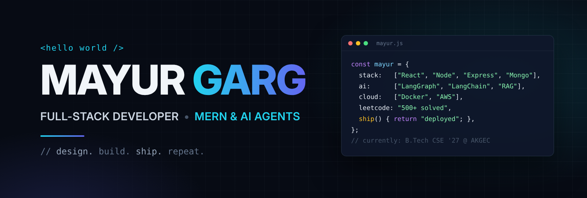
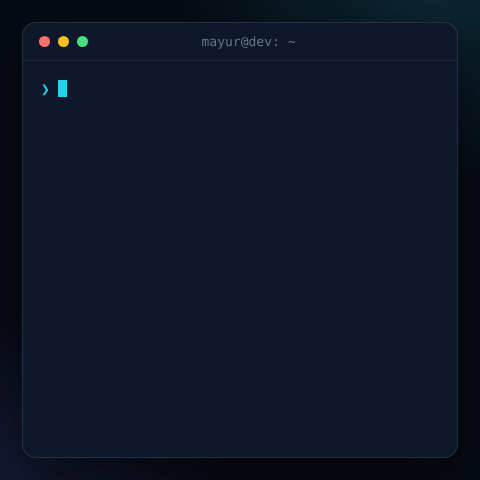
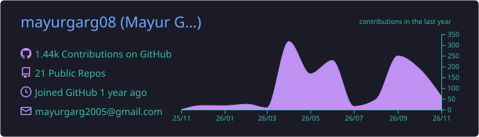
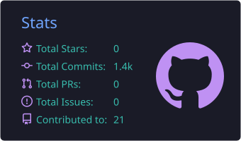
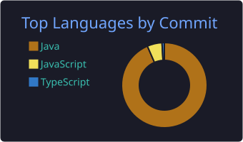

  

  <h1>Hi 👋, I'm Mayur Garg</h1>
  <h3>Full-stack MERN developer building microservices and multi-agent AI apps · 500+ LeetCode problems solved</h3>

  

    
    
    
    
  

  

---

### 🧑‍💻 About Me

<table>
  <tr>
    <td width="60%" valign="top">
      <ul>
        <li>🎓 <b>B.Tech in Computer Science</b> at Ajay Kumar Garg Engineering College, Ghaziabad (2023–2027) · CGPA <b>8.67/10</b></li>
        <li>💼 Former <b>MERN Stack Intern at ConsultIT Technologies</b>: built the NGO section of the DMS Aarohi Musical Society website, including an admin panel that lets non-technical staff update content themselves</li>
        <li>🤖 Currently building <b>multi-agent AI systems</b> with LangGraph, LangChain and RAG on top of a microservices backend</li>
        <li>🧩 Into <b>system design</b>: microservices, REST API design, component-based architecture</li>
        <li>🧠 <b>500+ problems</b> solved on LeetCode</li>
        <li>📫 Reach me at <b>mayurgarg2005@gmail.com</b></li>
        <li>⚡ Fun fact: my AI platform has 8 agents and I still debug with <code>console.log</code></li>
      </ul>
    </td>
    <td width="40%" align="center" valign="middle">
      
    </td>
  </tr>
</table>

---

### 🚀 Featured Projects

<table>
  <tr>
    <td width="50%" valign="top">
      <h3>🧠 CortexAI</h3>
      
<b>Multi-agent AI platform.</b> Gateway, Auth, Billing, Chat and Agent microservices, each in its own Docker container, deployed on AWS (ECR/ECS). A LangGraph router uses an LLM to work out what the user wants and sends the query to one of <b>8 specialised agents</b>: chat, web search, coding, PDF/PPT generation, image, and PDF-RAG on Qdrant. It works with several LLM providers: Gemini, Groq and OpenRouter.

      

        
        
        
        
        
      

      <a href="https://github.com/mayurgarg08/Cortex_AI"><b>Code</b></a> · <a href="https://mayur-cortexai.online/"><b>Live demo ↗</b></a>
    </td>
    <td width="50%" valign="top">
      <h3>💼 HireHut</h3>
      
<b>Career and job platform.</b> A resume builder with live editing and one-click PDF export, plus a job and internship tracker, courses, competitions and a networking feed. Real-time chat with Socket.IO, including typing indicators and online status. Sign-in uses JWT and Google OAuth, and there's a notifications system.

      

        
        
        
        
      

      <a href="https://github.com/mayurgarg08/HireHut"><b>Code</b></a> · <a href="https://mayur-hirehut.netlify.app/"><b>Live demo ↗</b></a>
    </td>
  </tr>
  <tr>
    <td width="50%" valign="top">
      <h3>🎥 VidChat</h3>
      
<b>Language exchange app.</b> Practise a language with real-time text chat and video calls, built on the GetStream.io Chat and Video SDKs. The React frontend and the Node/Express/MongoDB backend are separate codebases that talk over secured REST APIs, with JWT-protected routes.

      

        
        
        
        
      

      <a href="https://github.com/mayurgarg08/VideoChat-frontend"><b>Frontend</b></a> · <a href="https://github.com/mayurgarg08/VideoChat-backend"><b>Backend</b></a> · <a href="https://mayurvideochat.netlify.app/"><b>Live demo ↗</b></a>
    </td>
    <td width="50%" valign="top">
      <h3>🏛️ DMS Aarohi: NGO Portal</h3>
      
<b>Internship project at ConsultIT.</b> I built the NGO section of the site on my own from start to finish: six pages with a reusable React and Tailwind UI, a backend and database layer in Node, Express and MongoDB, and an admin panel so non-technical staff can manage the content without help.

      

        
        
        
        
      

      <i>Client project · June–August 2026</i>
    </td>
  </tr>
</table>

---

### 🛠 Languages and Tools

**Languages**

**Frameworks and backend**

**Cloud, DevOps and tools**

**AI stack:** &nbsp;

---

### 📊 GitHub Stats

  
  
  
   
  

### 🧩 LeetCode

  

### 🏅 Certifications

| Certification | Issuer |
|---|---|
| Certified MERN Developer: Advanced MERN Stack | Infosys Springboard |
| Certified React.js Developer: React & Redux | KnowledgeGate.AI |
| Certified Frontend Developer: HTML, CSS, JS, Bootstrap, Tailwind, React | Udemy |

---

  <i>Open to SDE internships and full-time roles: <a href="mailto:mayurgarg2005@gmail.com">let's talk</a>.</i>

